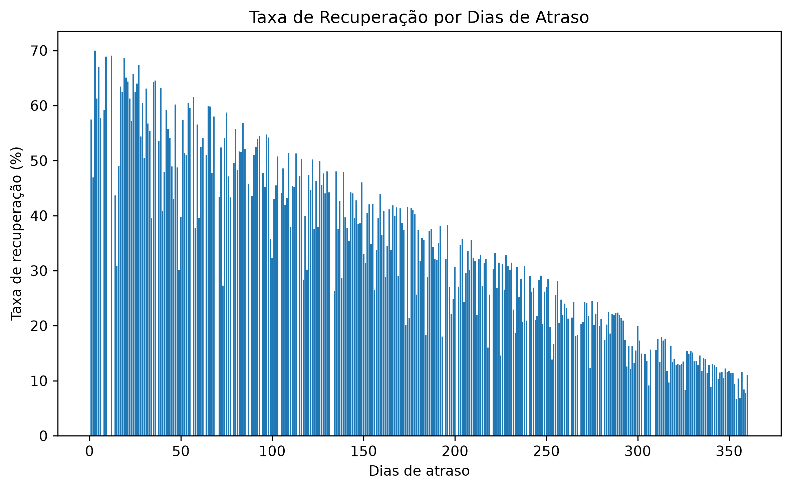

# Análise de Recuperação de Crédito NPL

Projeto de análise de uma carteira simulada de crédito inadimplente (NPL), utilizando Python e SQL para calcular indicadores de recuperação e identificar padrões por faixa de atraso.

## Objetivo

Analisar uma carteira de 1.000 clientes, avaliando valores de dívida, valores recuperados e taxas de recuperação conforme os dias de atraso.

## Tecnologias utilizadas

- Python
- Pandas
- SQLite
- SQL
- Matplotlib

## Análises realizadas

- Total da dívida e valor recuperado
- Saldo em aberto
- Taxa geral de recuperação
- Taxa de recuperação por cliente
- Análise por faixa de atraso
- Visualização gráfica dos resultados

## Principal insight

Na base simulada, clientes com mais de 90 dias de atraso apresentaram uma taxa de recuperação menor do que clientes com atrasos mais curtos.

## Estrutura do projeto

- `gerar_base.py`: geração da base simulada
- `analise.py`: análise dos dados com Python
- `criar_banco.py`: criação do banco SQLite
- `consulta_sql.py`: consultas e indicadores SQL
- `carteira_npl.csv`: base de dados simulada
- `carteira.db`: banco de dados SQLite

## Observação

Os dados utilizados são fictícios e foram gerados para fins de estudo e portfólio. Os resultados não representam uma carteira real.
## Visualização dos resultados

 